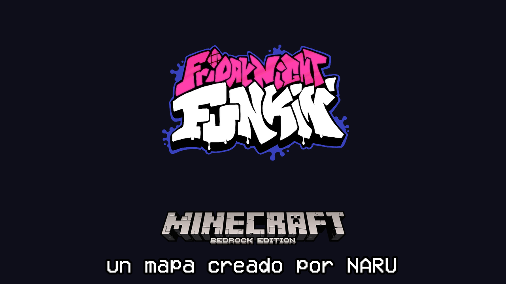
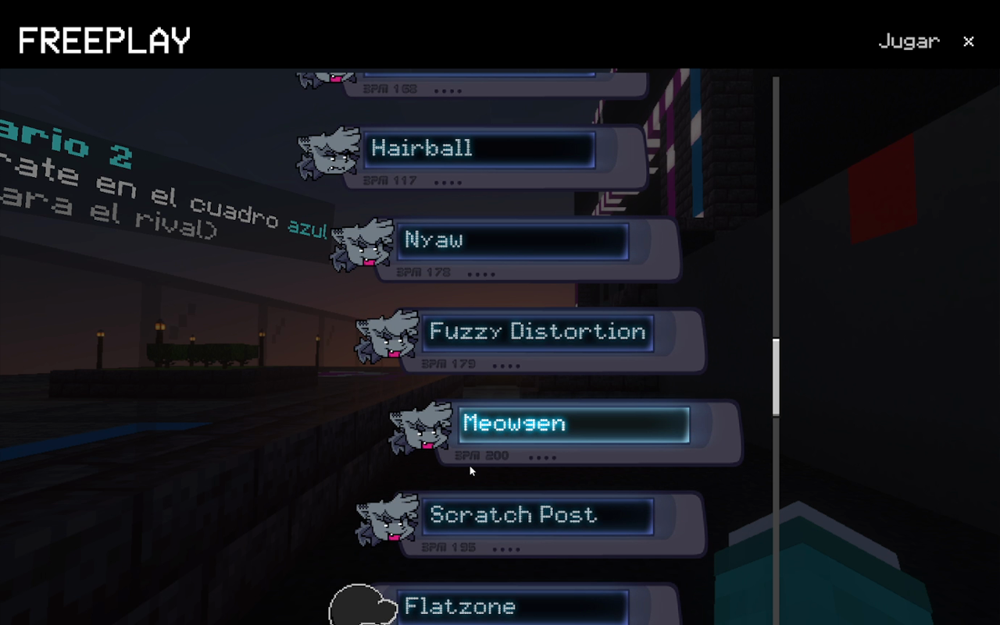
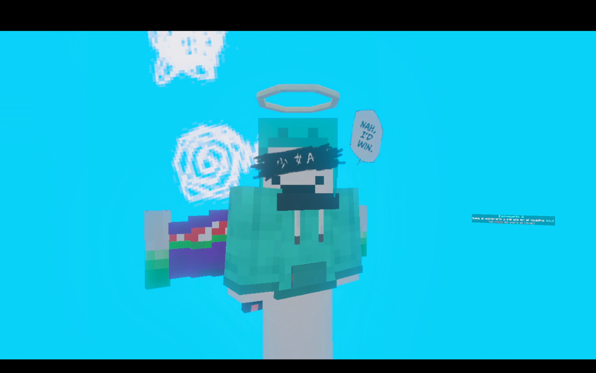
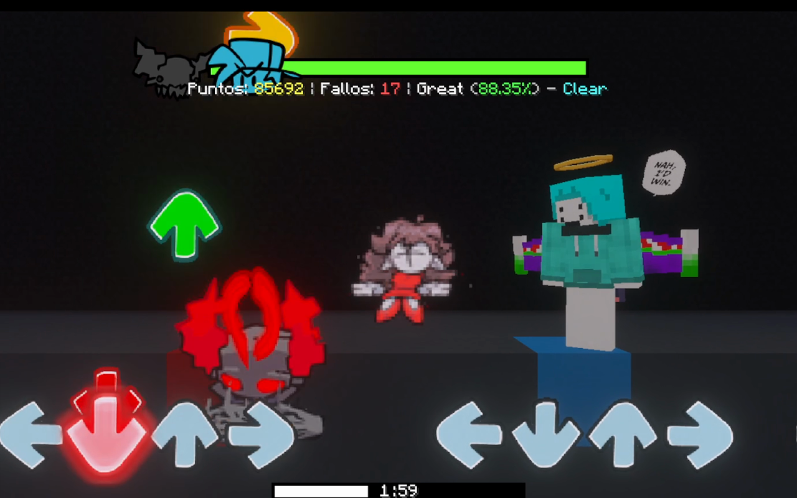

# FNF Minecraft Bedrock Map — By NARU

Un mapa de **Friday Night Funkin'** para **Minecraft Bedrock**, creado por **NARU**.

## ✨ Qué incluye

- **+42 canciones**, con menús al estilo del juego original (Freeplay, pausa, resultados, créditos…)
- **Mods completos:** Indie Cross (Cuphead, Sans, Bendy…), VS Tricky, VS Whitty, Wii Funkin' VS Matt, Arcade Showdown VS Kapi, Bite (Fernan Mix) y más
- **Young Girl A** con su cinemática completa
- **Modo Versus** (multijugador), **Modo Bot**, **Lobby** y mecánicas únicas por canción
- Downscroll, calibración, controles configurables y más

## 📸 Capturas

## ⬇️ Cómo instalar

1. Ve a la sección **[Releases](../../releases)** y descarga el archivo `.mcworld`.
2. Ábrelo (doble clic): Minecraft Bedrock lo importará como un mundo.
3. Entra al mundo y ¡a jugar!

## 🔗 Enlaces

- **YouTube:** https://youtube.com/@NARUBOY
- **Discord:** https://discord.gg/HA5gKcpsaq
- **Patreon:** https://patreon.com/cw/NaruAntoic

> El **código completo del mapa** está disponible para los miembros de mi Patreon, en el Discord.

## 📝 Créditos

Mapa hecho por fans, sin fines de lucro. **No es oficial** de Friday Night Funkin', de sus mods ni de Mojang. Cada mod y canción pertenece a sus respectivos creadores.
